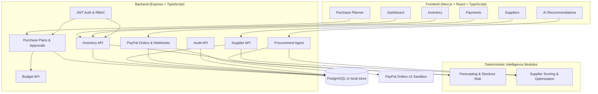

<div align="center">

# ⚡ StockWise Pay

### Cash-Aware AI Restocking for Small Electronics Retailers

_Turn inventory signals into explainable, budget-safe purchase decisions._

Inventory intelligence · Supplier comparison · AI procurement planning · PayPal Sandbox settlement

[](frontend/)
[](backend/)
[](backend/src/db/)
[](intelligence/)
[](supplier-intelligence/)
[](backend/src/routes/paypal.ts)
[](LICENSE)

</div>

---

## Table of Contents

- [Overview](#overview)
- [Core Workflow](#core-workflow)
- [System Architecture](#system-architecture)
- [Technology Stack](#technology-stack)
- [Project Structure](#project-structure)
- [Features by Workspace](#features-by-workspace)
- [Backend Services](#backend-services)
- [Data Architecture](#data-architecture)
- [Local Setup](#local-setup)
- [Environment Variables](#environment-variables)
- [Authentication and Governance](#authentication-and-governance)
- [Testing](#testing)
- [Scripts](#scripts)
- [Deployment](#deployment)

---

## Overview

**StockWise Pay** is a full-stack procurement workspace for small electronics
retailers. It combines demand forecasting, stockout-risk analysis, supplier
comparison, budget-constrained restocking, explainable recommendations, and
audited PayPal Sandbox payments in one workflow.

The application is designed around a simple rule: a recommendation is useful
only when it is financially actionable. Inventory risk is calculated first,
supplier offers are compared next, and the procurement optimizer guarantees
that the resulting plan does not exceed the available budget.

### Key Highlights

- **Inventory-aware forecasting** — SMA and EMA demand baselines with trend and stockout-risk classification
- **Cash-aware planning** — risk-prioritized restocking with supplier MOQ and budget constraints
- **Explainable recommendations** — plain-language reasons, warnings, and review checkpoints for every plan
- **Supplier comparison** — price, lead time, reliability, MOQ, and volume-discount evaluation
- **Approval governance** — versioned plans, manager approval, rejection notes, and audit history
- **Secure payment flow** — server-controlled totals, PayPal Orders v2 Sandbox integration, and idempotent capture
- **Explicit persistence modes** — PostgreSQL for real payment execution; local storage is clearly marked for development-only simulation

---

## Core Workflow

```text
┌─────────────────────────────────────────────────────────────────────┐
│  INVENTORY INTELLIGENCE                                             │
│  Sales history → Demand forecast → Stockout risk → Reorder signal   │
└──────────────────────────────┬──────────────────────────────────────┘
                               │
                               ▼
┌─────────────────────────────────────────────────────────────────────┐
│  SUPPLIER INTELLIGENCE                                              │
│  Offers → Price/lead-time/reliability scoring → Best supplier      │
└──────────────────────────────┬──────────────────────────────────────┘
                               │
                               ▼
┌─────────────────────────────────────────────────────────────────────┐
│  PROCUREMENT PLANNER                                                │
│  Risk priority → MOQ-aware quantities → Budget-safe purchase plan  │
└──────────────────────────────┬──────────────────────────────────────┘
                               │
                               ▼
┌─────────────────────────────────────────────────────────────────────┐
│  GOVERNANCE & SETTLEMENT                                            │
│  Explain → Approve → Version-lock → PayPal order → Capture → Audit │
└─────────────────────────────────────────────────────────────────────┘
```

**Purchase plan lifecycle:**

```text
DRAFT → PENDING_APPROVAL → APPROVED → PAID
          │                    │
          └──────────────→ REJECTED

Any budget or line-item change creates a new version and invalidates approval.
```

---

## System Architecture



---

## Technology Stack

| Layer | Technologies |
|---|---|
| Experience | Next.js 14 App Router, React 18, TypeScript, Tailwind CSS, Recharts, Lucide React |
| API | Node.js, Express, TypeScript, Zod, Multer |
| Intelligence | TypeScript, SMA/EMA forecasting, deterministic risk and budget optimization |
| Persistence | PostgreSQL 14+, Supabase, or Neon for payment execution; local JSON only for explicit development simulation |
| Authentication | JWT, bcryptjs, role-based permissions, token revocation |
| Payments | PayPal Orders v2 REST API in Sandbox mode |
| Tooling | npm workspaces-by-prefix, tsx, TypeScript compiler, Node test runner |

---

## Project Structure

```text
Stockwise-Pay/
├── backend/
│   ├── src/
│   │   ├── db/              # Schema, migrations, seed data, persistence adapter
│   │   ├── middleware/      # Authentication and authorization
│   │   ├── routes/          # Auth, inventory, suppliers, plans, agent, PayPal, audit
│   │   └── services/        # Procurement and PayPal services
│   └── tests/               # Backend API tests
├── frontend/
│   └── src/
│       ├── app/             # Next.js routes and page UI
│       ├── context/         # Authentication context
│       ├── services/        # Backend API client and local fallback
│       └── types/           # Shared frontend types
├── intelligence/            # Demand forecasting and inventory risk module
├── supplier-intelligence/   # Supplier scoring, optimization, simulation, explanations
├── LICENSE
└── README.md
```

---

## Features by Workspace

### 📊 Executive Dashboard

| Feature | Description |
|---|---|
| Inventory overview | Inventory valuation, retail potential, turnover, and low-stock signals |
| Budget monitor | Monthly cap, spent amount, allocated amount, and remaining cash |
| Analytics | Category valuation and spend pace visualizations |
| Depletion alerts | Critical SKUs with runway estimates and restock actions |
| Purchase plans | Active plans and approval status at a glance |

### 📦 Inventory

| Feature | Description |
|---|---|
| Catalog | SKU, category, safety stock, costs, selling price, margin, and vendor |
| Risk status | In stock, low stock, critical low, and out-of-stock indicators |
| Search and filters | SKU/name/vendor search, category/status filters, and sorting |
| CSV import | Upload, validate, preview, and batch-import catalog data |
| Analysis | Forecast demand, estimate runway, calculate reorder points, and classify risk |

### 🤝 Suppliers

| Feature | Description |
|---|---|
| Comparison matrix | Compare price, delivery lead time, MOQ, reliability, and rebates |
| Scoring preferences | Balanced, cheapest, fastest, and most reliable supplier strategies |
| Supplier directory | Supplier contacts, locations, specialties, and payment terms |
| Budget fit | Match offers and quantities to the available purchasing budget |

### 🧮 Purchase Planner

| Feature | Description |
|---|---|
| Scenario modes | Balanced, aggressive growth, and conservative cash-flow planning |
| Editable plans | Toggle lines, change quantities, switch suppliers, and recalculate totals |
| Budget guarantee | The optimizer mathematically prevents allocation above the budget cap |
| Version history | Immutable snapshots with deltas and change reasons |
| Approval workflow | Approve or reject with version locking and audit notes |

### 🤖 AI Recommendations

The procurement agent orchestrates the inventory and supplier intelligence modules
through controlled analytical tools. It returns grounded explanations rather than
untracked recommendations, including stockout runway, margin, lead-time, supplier
selection, excluded items, and review warnings.

### 💳 Payments

- PayPal Orders v2 Sandbox order creation and capture
- Server-enforced order totals derived from the approved purchase plan
- Approval and version checks before checkout
- Capture locking and idempotency protection against duplicate charges
- Payment history, status checks, webhook logging, and audit records

---

## Backend Services

| Service | Location | Responsibility |
|---|---|---|
| Authentication | `routes/auth.ts`, `middleware/auth.ts` | Login, JWT sessions, logout revocation, permissions |
| Inventory | `routes/inventory.ts` | Catalog CRUD, CSV import, inventory analysis |
| Suppliers | `routes/suppliers.ts` | Supplier directory, offers, and SKU comparison |
| Plans | `routes/plans.ts` | Plan generation, recalculation, versions, approval, rejection |
| Agent | `routes/agent.ts`, `services/agent.ts` | Tool orchestration, simulations, recommendation status |
| Budget | `routes/budget.ts` | Monthly budget and spend configuration |
| Payments | `routes/paypal.ts`, `services/paypal.ts` | PayPal order lifecycle, capture, webhooks, payment ledger |
| Audit | `routes/audit.ts` | Immutable operational and approval event history |

### API Surface

| Group | Base path | Key operations |
|---|---|---|
| Auth | `/api/auth` | Login, logout, current user |
| Inventory | `/api/inventory` | List, analysis, create, batch import, CSV import, delete |
| Suppliers | `/api/suppliers` | List, offers, compare by SKU |
| Plans | `/api/plans` | Generate, list, recalculate, explain, versions, approve, reject |
| Agent | `/api/agent` | Analyze, simulate, inspect runs, recommendation status |
| Budget | `/api/budget` | Read and update budget configuration |
| PayPal | `/api/paypal` | Create/capture orders, status, history, webhook |
| Audit | `/api/audit-logs` | Read audit events |

---

## Data Architecture

### Operational Tables

| Table | Purpose |
|---|---|
| `products` | Electronics catalog, pricing, stock, safety stock, and sales history |
| `suppliers` / `supplier_offers` | Supplier profiles and SKU-level commercial offers |
| `purchase_plans` / `plan_versions` | Current plans and immutable planning snapshots |
| `approvals` | Version-specific manager decisions |
| `payments` / `payment_events` | PayPal settlement records and event history |
| `inventory_imports` | Import counts, validation results, and status |
| `ai_agent_runs` | Tool calls, results, execution status, and duration |
| `audit_logs` | Actor, action, entity, status transitions, and details |
| `budget_config` | Monthly cap, spent amount, and allocated amount |
| `users` / `revoked_tokens` | Role-based accounts and persistent logout revocation |
| `webhook_events` / `capture_attempts` | Webhook deduplication and distributed capture coordination |

The schema is in [`backend/src/db/schema.sql`](backend/src/db/schema.sql) and
supports PostgreSQL 14+, Supabase, and Neon. When `DATABASE_URL` is omitted,
the backend uses an explicitly reported local store for development-only simulation. If `DATABASE_URL` is set but unavailable, startup fails closed; it never silently falls back.

---

## Local Setup

### Prerequisites

- Node.js 18+
- npm
- PostgreSQL 14+ (required for real payment execution)
- PayPal Sandbox credentials from one REST application (required for real payment execution)

### Install dependencies

Install each package using its checked-in lockfile:

```bash
npm install
npm --prefix backend install
npm --prefix frontend install
npm --prefix intelligence install
npm --prefix supplier-intelligence install
```

### Configure environment

```bash
cp backend/.env.example backend/.env
cp frontend/.env.example frontend/.env.local
```

Add database and PayPal values when those integrations are required. Never
commit `.env` or `.env.local` files.

### Initialize and run

```bash
# Apply schema and seed data
npm run migrate

# Terminal 1: Express API
npm run dev:backend

# Terminal 2: Next.js frontend
npm run dev:frontend
```

| Service | URL |
|---|---|
| Frontend | http://localhost:3000 |
| API | http://localhost:5000 |
| Health check | http://localhost:5000/api/health |

---

## Environment Variables

### Backend (`backend/.env`)

| Variable | Description | Required |
|---|---|---|
| `PORT` | Express listening port; defaults to `5000` | Optional |
| `NODE_ENV` | Runtime environment | Optional |
| `FRONTEND_URL` | Allowed frontend origin | Optional |
| `DATABASE_URL` | PostgreSQL connection string | Required for real payments |
| `PAYPAL_API_BASE` | PayPal API base URL; Sandbox by default | Optional |
| `PAYPAL_CLIENT_ID` | PayPal Sandbox client ID | For PayPal |
| `PAYPAL_CLIENT_SECRET` | PayPal Sandbox secret | For PayPal |
| `PAYPAL_WEBHOOK_ID` | PayPal webhook ID | For webhook verification |
| `PAYPAL_SIMULATION_ENABLED` | Explicit non-payment demo mode | Optional; never use for real payments |
| `GEMINI_API_KEY` | Optional freeform AI integration key | Optional |
| `OPENAI_API_KEY` | Optional freeform AI integration key | Optional |

### Frontend (`frontend/.env.local`)

| Variable | Description | Required |
|---|---|---|
| `NEXT_PUBLIC_API_URL` | Backend API base URL | Optional |
| `NEXT_PUBLIC_PAYPAL_CLIENT_ID` | Public client ID from the same PayPal Sandbox REST app as the backend | Required for Smart Buttons |

---

## Authentication and Governance

The backend uses bcrypt password verification, JWT access tokens, persistent
revocation on logout, and permission checks for protected actions. Demo roles
model three retail operations responsibilities:

- **Inventory Lead / Approver** — catalog, plan approval, and payment execution
- **Procurement Specialist** — catalog and supplier comparison, plan proposals
- **Chief Financial Officer / Treasury** — budget, audit, approvals, and settlements

Payment safeguards include server-controlled totals, explicit approval checks,
version-lock invalidation after plan changes, PayPal status verification, webhook
deduplication, and capture coordination for concurrent requests.

---

## Testing

Run all module tests:

```bash
npm test
```

Run focused suites:

```bash
npm run test:intelligence
npm run test:suppliers
npm run test:backend
```

Type-check the intelligence modules:

```bash
npm --prefix intelligence run check
npm --prefix supplier-intelligence run check
```

Build both application layers:

```bash
npm run build
```

---

## Scripts

| Command | Purpose |
|---|---|
| `npm run dev:backend` | Start the Express development server |
| `npm run dev:frontend` | Start the Next.js development server |
| `npm run migrate` | Apply the backend database migration |
| `npm test` | Run intelligence, supplier, and backend tests |
| `npm run build` | Build backend and frontend production bundles |
| `npm --prefix intelligence run report` | Generate an inventory report demonstration |
| `npm --prefix intelligence run compare` | Compare forecasting models |

---

## Deployment

Build the backend and frontend with:

```bash
npm run build
```

Run the compiled API with:

```bash
npm --prefix backend start
```

For production, provide a managed PostgreSQL connection, strong secrets,
PayPal production credentials only after Sandbox validation, a restricted
`FRONTEND_URL`, and HTTPS for all browser/API traffic. Keep all server-only
credentials out of frontend environment variables and source control.
